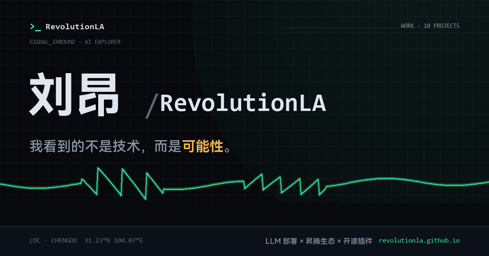

# RevolutionLA.github.io

> 刘昂（RevolutionLA）的个人主页 —— 极简科技风 · AI 技术探索者。
> 线上地址：<https://revolutionla.github.io/>

单文件首页（零第三方请求、自托管字体子集）+ 一套「自己量自己」的主张对账工具：**页面上的每一句事实主张（star 读数、收录数量、链接有效性、sitemap 时效），都被 [`tools/check-claims.py`](tools/check-claims.py) 逐条对账，失败即红。** 这个主页没有一句吹出来的话。



## 本地预览

```bash
git clone https://github.com/RevolutionLA/RevolutionLA.github.io.git
cd RevolutionLA.github.io
python -m http.server 8000   # 打开 http://localhost:8000
```

## 主张对账

```bash
python tools/check-claims.py
```

- 退出码 `0`：全部主张成立；
- 退出码 `1`：至少一条主张为假（去修页面）；
- 退出码 `2`：环境无法判定（网络/依赖），不算通过也不算失败。

对账已接入 CI（[`.github/workflows/check.yml`](.github/workflows/check.yml)），每次 push / PR 自动执行；`--selftest` 会主动制造一条假主张并断言检查器能抓到它——**不能失败的检查不是检查**。

## 目录结构

| 路径 | 说明 |
|---|---|
| `index.html` | 单文件首页（首屏 + 项目橱窗 + 叙述） |
| `assets/` | 样式、脚本、自托管字体子集与 og 图 |
| `tools/check-claims.py` | 页面主张对账器（无第三方依赖） |
| `tools/gen-og-image.py` | og 卡片图生成 |
| `sitemap.xml` / `robots.txt` | SEO 基础设施，lastmod 与线上部署对账 |

## 相关项目

- [adversarial-review](https://github.com/RevolutionLA/adversarial-review) — 三方对抗式代码评审 Agent Skill（同一套「每条结论带证据链」哲学）
- [dsh-dream-skin](https://github.com/RevolutionLA/dsh-dream-skin) — DeepSeek Harness 换肤 / 壁纸 / 主题包插件
- [awesome-YuE](https://github.com/RevolutionLA/awesome-YuE) — YuE / YuE2 开源音乐生成生态精选清单

## License

[MIT](LICENSE) © 2026 RevolutionLA
